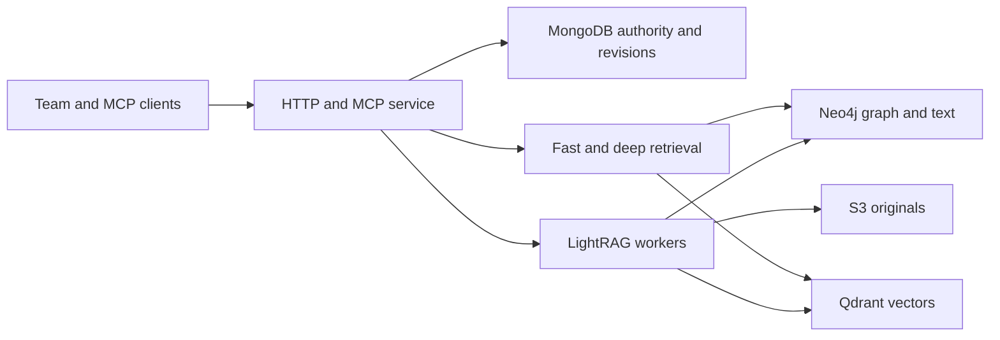

# Domain KG MCP Server

Domain KG is a shared web service under development for preserving work materials, constructing traceable knowledge graphs, and retrieving evidence through MCP and HTTP. Users manage multiple KGs, control access, add or replace materials, and remove a material without removing evidence supplied by other materials.

**Status:** Identity, scoped ingestion/retrieval, immutable publication, durable curation, HTTP/MCP and validated legacy imports have local implementations and real-store checks. The team console has passed its local smoke and representative browser checks; backup/restore and release evaluation remain in progress. External identity/client acceptance and live extraction quality are separate release gates. See [implementation progress](docs/implementation-progress.md).

## Laptop smoke checks

For the lowest-cost checks, use `python3 scripts/smoke.py --quick --offline`.
The checked-in [laptop profile](config/laptop-smoke.json) fixes Docker RAM,
native model RSS monitoring, serial execution and opt-in small-model budgets.
Ordinary tests make zero live model calls. See [budget details](docs/laptop-smoke.md)
and [the current feature review](docs/status-review.md).

```bash
uv sync --locked
python3 scripts/smoke.py --offline
```

The offline smoke runs lint, strict type checks, mounted MCP transport, source-preserving LightRAG extraction, identity mapping, and deferred embedding/flush characterization with tiny fixtures. It uses no external model service or model downloads.

Run `python3 scripts/smoke.py --task 1` for real MongoDB, Neo4j, Qdrant, and S3 checks. The four services have hard limits totalling 1,408 MiB (1.476 GB), below the 1.5 GB RAM cap, with swap disabled and 2.5 CPU cores in total. The runner verifies configured and running limits, generates private local credentials, uses loopback ports, and stops services it started. See [runtime and integration decisions](docs/decisions/0001-runtime-and-lightrag.md) for the unverified gates.

`uv run python -m domain_kg` starts the loopback app on port 8000. With a configured external OIDC issuer/client and approved backend/provider configuration, `/admin`, `/api/v1` and `/mcp` use the shared current-policy services. Without identity configuration, the default protected probe denies access. `GET /healthz` reports coarse status. See [identity setup](docs/identity-development.md), [transports](docs/transports.md) and the [console guide](docs/console.md).

## Recommended design

Use Python, FastAPI, the official MCP Python SDK, **LightRAG**, **Neo4j**, **Qdrant**, **MongoDB**, and S3 compatible storage. MongoDB owns permissions, material versions, source evidence, revision history, and publication manifests. Neo4j serves the graph and full text indexes; Qdrant serves filtered vectors. The service has no relational database or SQL persistence layer.

LightRAG is the core construction and retrieval integration. Source-aware adapters extend its workspace filtering to material, node, revision, and permission filters. Node edits survive re-ingestion, changed files reuse unchanged processing artifacts, and graph/vector updates publish only after readiness checks. MongoDB acceptance is coordinated with rebuildable projections; no distributed transaction is assumed.



## Planning documents

| Document | Purpose |
| --- | --- |
| [System design](docs/design.md) | Scope, users, storage boundaries, evidence model, ingestion, filtering, deletion, and operations |
| [Revision and publication protocol](docs/revisions-and-publication.md) | Durable edits, source changes, projection readiness, and recovery |
| [Code review and reuse](docs/code-reuse.md) | Inspected PhageAgent modules, concrete limitations, reuse boundaries, and migration approach |
| [MCP and HTTP contracts](docs/contracts.md) | Roles, tools, API routes, request limits, response shapes, and common interfaces |
| [Implementation plan](docs/implementation-plan.md) | Ordered implementation tasks, dependencies, files, checks, milestones, and effort estimates |
| [Acceptance and evaluation](docs/acceptance.md) | Release gates for permissions, graph quality, retrieval, lifecycle, and recovery |
| [Research and skills](docs/research-and-skills.md) | Primary sources, current KG alternatives, and planning skills reviewed |

The initial vertical slice is: an authorized editor uploads a PDF into one KG, a worker publishes its version, and an authorized reader retrieves cited evidence while an unauthorized user cannot discover it.

## First release scope

- Team login, organization membership, local groups, service identities, per-KG roles, and restricted-material grants.
- A catalog of KGs and registered storage databases, with health, read-only mode, statistics, quotas, backup, restore, export, and archive operations.
- PDF, scanned PDF, DOCX, Markdown, text, HTML, and CSV/JSON material ingestion; original file preservation and stable citations.
- Versioned domain schemas, typed entity and assertion extraction, source evidence, entity resolution, and manual curation.
- Fast vector/text retrieval and deep graph exploration, sharing material/node filters, permissions, and explicit cross-KG selection.
- Revision-aware node and relationship edits, history, merge/split, rollback, and incremental raw material changes.
- Durable background jobs, safe replacement and deletion, an administration console, audit records, and a reproducible deployment.

Legacy Word `.doc` files require an explicitly configured conversion worker; Google Docs require export or a future connector. Additional office formats, rich figure understanding, community summaries, and temporal reasoning are staged extensions.

The repository has no production credentials, copied corpus, or provider configuration. It has no GitHub remote. Existing skill installation details are retained in the research document; this design revision does not install or modify skills.
