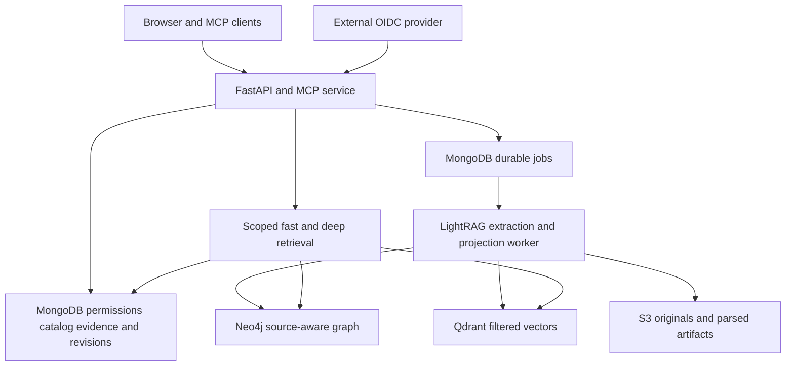

# Domain KG system design

## Purpose and release boundaries

Domain KG is a shared web MCP service for preserving work materials, constructing traceable knowledge graphs, and retrieving evidence. Users and groups manage multiple KGs, revise nodes and relationships, filter materials and graph content, and replace or remove source files.

The accepted architecture uses **LightRAG, Neo4j, Qdrant, MongoDB, and S3 compatible storage**. Domain KG has no relational database or SQL persistence layer. LightRAG is the core construction and retrieval integration from the first milestone. The service adds source-aware filtering, durable revision history, permissions, and coordinated publication.

Planning assumptions are 5–25 users, 2–10 KGs, ten concurrent searches, and a 100,000-chunk benchmark. These are sizing assumptions to validate. The default deployment serves one organization; organization and KG namespaces prevent sharing when more are added.

## Component responsibilities

| Component | Responsibility |
| --- | --- |
| Python 3.12, FastAPI, official MCP Python SDK | HTTP and Streamable HTTP MCP, shared services, management console |
| LightRAG | Document-to-graph construction, extraction/resolution integration, graph/vector retrieval orchestration |
| MongoDB replica set | Authoritative KG catalog, permissions, material versions, source evidence, revision journal, publication manifests, jobs, and audit |
| Neo4j | Source-aware entity/assertion/support projections, bounded traversal, and full text indexes |
| Qdrant | Chunk and source-bound entity/relation vectors with indexed payload filters and revision-specific point IDs |
| S3 compatible storage | Immutable originals, parsed artifacts, and backup manifests |
| External OIDC provider | Human login and service authentication; no local password store |
| Separate workers | Parsing, extraction, embeddings, projection updates, cleanup, and repair |
| Jinja2 and HTMX | KG, material, revision, permission, and operations screens |

Use MongoDB for LightRAG KV/document-status storage where supported and separate application-owned collections for authority/history. Stock LightRAG records do not replace the service's evidence and permission ledger. Neo4j and Qdrant are rebuildable serving projections. MongoDB transactions apply within the configured replica set; they do not include the other stores. [MongoDB transactions](https://www.mongodb.com/docs/manual/core/transactions/).

Pin exact LightRAG, SDK, driver, parser, model, and container versions in Task 1. Upstream supports this backend combination; source-aware adapters and revision publication are project work. The inspected Qdrant query implementation supplies a workspace filter rather than a general material/ACL filter interface. [Backend support](https://github.com/HKUDS/LightRAG/blob/main/docs/LightRAG-API-Server.md#storage-types-supported), [Qdrant adapter](https://github.com/HKUDS/LightRAG/blob/main/lightrag/kg/qdrant_impl.py).

## Components and trust boundaries

Only the service and workers access storage and the private LightRAG runtime. Do not expose an unguarded LightRAG endpoint or direct database access. MCP and HTTP share policy, revision, and retrieval services. Requests cannot select database commands, credentials, or server filesystem paths.

Integrate LightRAG through a version-pinned adapter, using supported APIs where possible and isolating backend extensions behind contract tests. Task 1 must prove source-preserving extraction and propagation of an immutable `ReadScope` through graph and vector operations. Record any maintained upstream patch. Never silently fall back to broad workspace retrieval when a requested restriction cannot be enforced.

## Multiple KGs and storage management

Distinguish a logical `knowledge_base`, registered `backend_instance`, and `storage_profile`. A profile bundles approved MongoDB, Neo4j, Qdrant, and object-store references. One KG uses one profile, explicit namespaces, an embedding profile, a domain schema, and a published revision.

KGs may share a profile or use independent endpoints. Validate both, including a second physical graph/vector deployment. Namespace every store, workspace, job, cache, and citation by organization and KG UUIDs. Neo4j multi-database features depend on deployment/edition; shared instances use explicit namespace properties and a second registered instance provides physical isolation when needed. Entity names never establish cross-KG identity.

Operators register approved connection-secret references and validate capabilities, index/schema versions, health, and placement policy. Owners select permitted placements without providing DSNs or passwords. Registration does not provision database servers. A referenced backend cannot be detached.

KG states are `provisioning`, `ready`, `read_only`, `archived`, and `error`; backend health is `healthy`, `degraded`, or `unavailable`. Projection/publication status is separate. The console shows accepted/pending revisions, graph/vector lag, failures, quotas, and repair controls. Archiving or purging one KG never drops shared infrastructure.

## Users and permissions

Key identities by OIDC issuer and subject. Organization administrators admit users, manage local groups/service identities, and create KGs. KG grants are `owner`, `editor`, and `reader`. Readers inspect permitted evidence; editors ingest, revise, curate, and remove accessible materials; owners also manage configuration, grants, schema, archive, backup, restore, and purge. Operators have infrastructure privileges without implicit application data access.

Materials use `acl_mode=kg` or `acl_mode=restricted`. Restricted grants narrow KG membership; they cannot confer KG access. Owners manage all material ACLs in their KG. Prevent concurrent removal of the last organization administrator or KG owner using MongoDB compare-and-set/transaction checks. Owner appointment is explicit and audited.

Build immutable `AccessContext` from verified credentials and current memberships, groups, grants, suspension state, and policy revision. `ReadScope` adds a published view and request filters. Repositories require this scope. MongoDB validators and compound unique indexes check shape/uniqueness; application reference validation and reconciliation enforce cross-document and cross-store namespace integrity.

All retrieval branches constrain organization, KG, accepted source versions, current tombstones, suppression, and metadata. Names, aliases, descriptions, counts, paths, exports, and citations derive only from visible support. Do not serve a merged LightRAG description when its sources cannot be restricted. An invisible alias cannot seed retrieval and an invisible assertion cannot bridge a path.

Recheck policy and material-visibility revisions before returning results. An authority outage denies policy resolution. Projection ACL mirrors are accelerators, not authority. Console sessions use secure cookies and CSRF protection; MCP validates resource-bound access tokens and protected-resource discovery through the selected SDK. [MCP authorization](https://modelcontextprotocol.io/specification/2026-07-28/basic/authorization).

## Material and evidence records

| Record | Purpose |
| --- | --- |
| `material`, `material_version` | Stable identity, immutable raw versions/hashes, metadata, ACL, lifecycle |
| `source_block`, `chunk` | Parsed text and page/paragraph/table/row location with parser and chunking provenance |
| `entity`, `entity_observation` | Stable internal UUID with source-bound names, types, aliases, descriptions |
| `assertion`, `assertion_support` | Typed fact, qualifiers, polarity, confidence, and independent supporting spans |
| `curation_revision` | Human edit, rename, merge, split, suppression, or reversal with actor and scope |
| `publication_manifest` | Accepted source/curation references, index generation, projection receipts, published revision |
| `job`, `outbox`, `audit` | Leases, idempotency, durable events, outcomes, and recovery |

All references include organization and KG. Stable IDs are independent of filenames and LightRAG name hashes. Keep an explicit engine-name mapping and alias redirects. Entity/relation vectors are source-observation or curation-revision specific; a mixed-access global description cannot be a serving candidate.

Version domain schemas for entity types, predicates, legal endpoints, and literals. Ship a general work profile and a separate scientific profile. Preserve conflicting and negated claims with source qualifiers. A validated span establishes source correspondence, not truth. Keep manual corrections separately from generated descriptions so re-ingestion cannot erase them.

## Raw material ingestion and changes

The pipeline is: authorize/reserve quota; preserve the upload; parse immutable blocks; chunk; run LightRAG extraction; validate source spans/schema; resolve stable IDs; stage graph/vector revisions; verify projection acknowledgements; publish.

Use Docling for PDF, scanned PDF, and DOCX behind a parser interface. Deterministic parsers handle Markdown, text, sanitized HTML, CSV rows, and JSON pointers. PDF cites physical page/block locations; DOCX cites headings/paragraphs/tables. Retain OCR warnings. Legacy `.doc` needs configured sandboxed conversion; cloud documents initially require export. Rich image/equation understanding is staged separately.

Target 700-token chunks with at most 100 tokens overlap, preserving headings and table row locations. Uploads are limited to 50 MiB and PDF jobs to 500 pages. Bound decompressed archive size, OCR work, and runtime; HTML executes no scripts or linked fetches. Unclaimed uploads expire after 24 hours.

Raw SHA-256 identifies byte versions; versioned normalized hashes support authorized processing reuse. Reuse cannot reveal existence across organizations, KGs, or visibility classes. Metadata-only changes update authoritative filtering without re-embedding unchanged text. Content changes create a new version; diff parsed blocks and reuse unchanged extraction/embedding artifacts while retaining version-specific ownership and source records.

Delta processing is an explicit service extension. Recompute the affected observations, assertions, curation targets, and vectors. Parser/schema/embedding changes may require broader reprocessing. A failed replacement leaves the prior accepted version searchable.

## Node and relationship revisions

Support editing names/types/descriptions/aliases, editing supported relationships, merge/split, suppress/restore, revision inspection, and rollback. Every command uses an expected revision and idempotency key. Rollback appends a compensating revision under current permissions and never restores old grants.

Use LightRAG mutation APIs where their semantics fit, operating through isolated staging or scoped adapters so accepted records cannot be changed directly. Retain the authoritative journal and stable IDs in MongoDB. Refresh affected entity/relation vectors when embedded content changes. Metadata-only tags do not need embeddings. Suppression immediately fences all retrieval branches and survives re-ingestion. Merge/split retains source supports, alias redirects, and reversible mappings. [LightRAG mutation APIs](https://github.com/HKUDS/LightRAG/blob/main/lightrag/lightrag.py).

Curation defaults to the editor's visible source scope; a KG-wide public override requires an explicit owner-authored curation record. Generated observations and human overrides remain distinguishable. A manually asserted relationship has manual provenance, not an invented source quotation.

## Publication and recovery

[Revision and publication protocol](revisions-and-publication.md) defines the state machine. MongoDB owns the accepted view. Neo4j/Qdrant project immutable source and curation revisions. Stage changed records, verify readiness, then compare-and-set the MongoDB manifest. There is no distributed transaction across stores.

Source eligibility comes from the accepted manifest and current visibility ledger. Unpublished versions cannot seed queries or contribute edges/summaries. Accepted records are not overwritten in place; retained views can serve already pinned reads. Unchanged source artifacts are reused, so an edit does not require a full-KG clone.

Use durable MongoDB leases, per-KG publication fencing, checkpointed retries, and attempt-specific projection IDs. Recheck actor access, KG state, tombstones, and expected revisions before publication. A stale worker cannot publish or overwrite accepted records. A projection failure retains the accepted view and creates a repair job. If that view cannot be verified, return `REVISION_NOT_READY` or `PROJECTION_INCONSISTENT` and fail closed.

## Retrieval modes and filters

`fast` is the default: filtered Qdrant vector recall and Neo4j full text recall with rank fusion. It uses no generative query/keyword LLM, graph expansion, or reranking. Query embeddings may use a configured embedding provider. `deep` adds scoped LightRAG graph exploration and optional reranking. Explicit `vector`, `lexical`, and `graph` modes support inspection/evaluation. Service modes are independent of native LightRAG mode names.

Deep mode uses a mix-style graph/vector workflow through context-aware adapters plus lexical recall. Every adapter call carries `ReadScope`. Query keyword generation is allowed only when explicitly enabled for deep mode and its latency is reported. No query performs extraction.

For each KG, resolve eligible material/version and curation sets from MongoDB; apply them to Qdrant payload filters and Neo4j support traversals before branch top-k. Index namespace, version, observation, and embedding-profile fields. Current authoritative metadata/grants determine eligibility even when projection payload mirrors lag. [Qdrant indexes](https://qdrant.tech/documentation/manage-data/indexing/), [Neo4j full text](https://neo4j.com/docs/cypher-manual/current/indexes/search-indexes/full-text-indexes/).

Start with 50 candidates per branch per KG. Deep/graph expansion is at most two hops, 200 nodes, and 400 edges, including seeds. Enforce caps during expansion and track visited nodes. Map every graph edge to visible support. Use reciprocal rank fusion with constant 60 and initial equal weights; optional deep reranking considers at most 50 candidates. Default final top-k is 10, maximum 50, and evidence text budget is 24,000 characters.

Filters cover KG/material IDs and exclusions, active or explicit retained version, media type, tags, author, source, language, dates, node IDs/types/exclusions, predicates, confidence, and support status. Lists are OR, fields are AND, `tags_all`/`tags_any` are separate, and time ranges are half-open UTC. Assertion restrictions constrain every branch before ranking. Unsupported filters fail explicitly.

Authorize every selected KG before cross-KG fan-out; preserve namespaces and fuse ranks across embedding profiles. There is a per-KG accepted view, not a distributed global snapshot. Empty visible evidence is successful. Caller-authorized partial results may cover failed retrieval branches; authority and publication-integrity failures cannot become partial success inside an affected KG.

## Removal and source ownership

Exclude hides reversibly; delete tombstones and fences immediately; purge removes retained live-store bytes according to policy. If A and B support a fact, removing A preserves B's evidence. Derived names, descriptions, and vectors must also avoid A after the fence. Global merged descriptions cannot bypass source checks.

Graph/vector/object cleanup follows visibility changes and checks shared references. Unsupported facts and suppressed nodes stay excluded while cleanup runs. Restore is a new authorized revision and waits for readiness. Retained backups have a separately documented expiry policy.

## Existing KGs and operations

Adapt PhageAgent client/gateway, normalization, source manifests, and evaluation ideas into the primary LightRAG integration. Import CSV triples, GraphML, and consistent LightRAG snapshots with old/new ID mappings. Missing originals become `imported_unverified` and are excluded from default verified evidence. Existing unfiltered gateways stay private/read-only until the same source and permission contracts pass.

Development Compose includes API, worker, a MongoDB replica set, Neo4j, Qdrant, and S3 compatible storage. Configure an external OIDC provider or a test-only issuer; no relational identity database is bundled. Production uses HTTPS, secret references, restricted networks, least-privilege accounts, encrypted storage, and preinstalled parser dependencies.

Backups capture the authoritative ledger/publication manifest, originals, curation history, and projection checkpoints. Restore into an inactive namespace and validate or rebuild projections before explicit current grants. Observe per-mode latency, projection lag, revision conflicts, repair jobs, provider usage, validation failures, and scoped audits.

Graphiti remains a future option for temporal questions. Community summaries and other engines need separate scope/invalidation designs. Release one proves fast filtered retrieval, persistent edits, source changes/removal, multiple profiles, and interrupted-update recovery.
