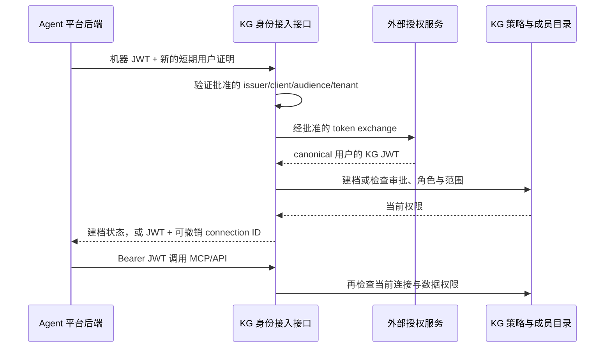

# Agent 平台身份接入与 MCP 连接

本接口让已拥有用户系统的 Agent 平台为其用户在 Domain KG 建档，并申请受限的 MCP/API 访问。用户无需再创建一套 KG 密码。平台确认用户身份，外部 OIDC/OAuth 授权服务签发 KG 接受的 JWT，KG 独立决定组织成员资格、KG 角色、来源权限及连接范围。

本文面向平台集成开发者、组织管理员与部署运维人员。授权服务和秘密配置见 [IdP 配置指南](identity-bridge-idp.md)，普通 MCP 调用见 [MCP Agent 指南](mcp-agent-guide.md)。完整机器契约见 [OpenAPI JSON](api/identity-bridge.openapi.json)，平台侧示例见 [Python client](../examples/identity_bridge_client.py)。默认不启用此功能；安装配置与创建已批准的 integration 后才开放对应平台。

## 1. 三种凭证与一条连接

| 对象 | 用途 | 谁管理 |
| --- | --- | --- |
| 平台机器 JWT | 调用建档、交换与同步接口；固定 issuer、audience、client、service subject 与 scope | 平台后端及已批准的授权服务 |
| 用户证明 JWT | 证明本次操作对应哪个已认证用户；有效期最多 120 秒，具有唯一 `jti` | 平台用户登录体系及已批准的签发方 |
| KG access token | 调用 `/mcp` 及普通 `/api/v1` 数据接口；绑定当前部署的 MCP resource audience，生命周期最多 600 秒 | KG 的 canonical OIDC/OAuth 授权服务 |
| Agent connection | KG 内的可撤销记录，约束组织、用户、应用、KG、操作和到期时间 | KG |

平台机器 token 不会变成 KG 用户，也不因为拥有 `identity:provision` 就能读取图谱。用户证明不能直接拿来调用 MCP。access token 即使签名正确，也必须符合 KG 的当前成员、权限及连接检查。

浏览器继续使用现有 OIDC 登录和服务端 session。该桥接流程不会创建浏览器 cookie；Agent 也不得复制浏览器 session。`Mcp-Session-Id` 只是 MCP 传输状态，每次请求仍需有效的 `Authorization: Bearer`。



KG 不是新的 OAuth issuer。通用 RFC 8693 请求适配器并不代表任意平台的 token 都可以交换；每个 IdP、版本和身份映射都须按 [IdP 指南](identity-bridge-idp.md) 单独验证。当前接口只接受可验签 JWT，没有 opaque-token introspection、密码注册或 refresh-token 接口。

## 2. 接入前的责任划分

**Operator** 配置受信任的 issuer、固定的应用与组织范围、token exchange client 和秘密。profile 文件只通过部署配置安装，页面和 MCP 都不能提交 issuer URL 或 client secret。普通用户、组织管理员不能自行增加新的受信任签发方。

**组织管理员** 从已批准 profile 创建 integration，确定允许的 KG、操作、初始角色、用户组映射和是否自动批准用户。执行创建的管理员还必须是每个目标 KG 的 owner。当前没有另一套“先提交，再由各 KG owner 分别审批”的流程。

**平台开发者** 验证平台侧登录，取得规定的用户证明，保护机器凭证，并在申请连接前向用户展示应用、KG、操作用途及期限。当前 KG 提供接入预批准、用户审批和连接撤销；平台负责其申请连接时的用户交互，不能把上游登录成功解释为用户同意任意操作。

建议首次接入使用独立测试组织、合成用户、一个 KG 及 `read/search`。测试不需要发送真实原文，也不需要调用模型 API。

## 3. Operator 安装与变更

1. 先配置正常工作的 canonical OIDC 登录与 MCP resource audience，见 [现有身份配置](identity-development.md)。
2. 在外部授权服务配置批准的机器 client、用户证明及 token exchange。交换后的用户必须有稳定 canonical `sub`，交换 client 必须专用。
3. 在 Git 外创建私有 JSON 配置，设置 `DOMAIN_KG_IDENTITY_BRIDGE_CONFIG` 指向它，再重启应用。文件必须是普通文件、不能是符号链接、不能有 group/world 权限，最大 1 MiB；推荐文件 `0600`、目录 `0700`。完整字段和示例见 [IdP 配置指南](identity-bridge-idp.md)。
4. 所有实例使用一致的配置和 `response_key`，并由组织管理员完成下一节的 integration 创建。生产部署使用 HTTPS；HTTP 仅限开发 loopback。

配置只在启动时加载，没有热更新接口。启动会核对已注册 integration 的 profile 指纹；缺失或非秘密字段发生变化时会停用不再匹配的接入，并撤销对应连接。恢复配置不会自动重新启用 integration；恢复原配置后再由管理员启用也不会复活旧连接。

`exchange_client_secret` 不参与信任边界指纹，可以在 IdP 和秘密配置中协调轮换后重启。其余 profile 字段被视为固定批准内容；不要原地复用旧 profile/client 指向另一平台、组织或身份映射。变更信任边界或 integration 的 KG/操作/默认授权策略时，应创建新的 profile、专用 exchange client 和 integration，验证后停用旧接入。`PATCH` 当前只支持启用或停用。

`response_key` 为 base64 编码的 32 个随机字节，用于 AES-GCM 加密短期 token 幂等响应，不能代替 JWT 签名或连接撤销。当前只有一个解密密钥，没有 key ring。轮换前可等待旧响应到期；轮换后旧缓存可能无法解密，平台须以新用户证明和新请求 key 申请。已有 access-token 绑定不依赖该密钥解密，换密钥不会自动撤销连接。不要在日志、命令行参数、工单或公开示例中记录密钥、JWT、完整请求体或 token 响应。

## 4. 管理员建立接入

浏览器进入 `/admin/identity-integrations`，或使用下表的管理 API。页面显示可用 profile 的名称与 ID，不显示秘密。没有 profile 时会明确提示联系 operator。

创建示例中的 UUID 仅作说明：

```http
POST /api/v1/identity-integrations
Authorization: Bearer <ordinary-human-admin-KG-JWT>
Content-Type: application/json
X-Domain-KG-Organization: 22222222-2222-4222-8222-222222222222

{
  "profile_id": "11111111-1111-4111-8111-111111111111",
  "name": "Research Agent",
  "allowed_kg_ids": ["33333333-3333-4333-8333-333333333333"],
  "allowed_actions": ["read", "search"],
  "default_grants": [
    {"kg_id": "33333333-3333-4333-8333-333333333333", "role": "reader"}
  ],
  "group_mappings": [],
  "auto_approve": false,
  "idempotency_key": "research-agent-admission-v1"
}
```

成功返回 `201` 与 `IntegrationView`，包含 `id/org_id/profile_id/name/allowed_kg_ids/allowed_actions/default_grants/group_mappings/auto_approve/active/revision`。新接入为 `active=true`、`revision=0`。把返回的 integration ID 分发给平台，client secret 留在服务器私有配置中。

| 配置 | 行为 |
| --- | --- |
| `allowed_kg_ids` | 最多 100 个、不得重复；只设允许范围，本身不授予用户 KG 角色 |
| `allowed_actions` | 默认 `read/search`；不能包含 `create_kg`、`manage_organization`、`register_backend` |
| `default_grants` | 仅为**新创建**成员授予 `reader/editor`，最多 100 项且必须在允许 KG 中；没有默认 owner |
| `group_mappings` | 最多 100 个一对一外部组名到现有本地组的映射；本地组已获授权的所有 KG 必须在允许 KG 中 |
| `auto_approve` | 默认 `false`，逐人审批；改为 `true` 表示组织预批准此受信平台的新身份关联 |

同一个 canonical issuer 的 exchange client 只能登记到一个 integration，不能靠换 integration ID 复用。创建和后续修改均由当前权限检查及审计保护。

页面为每个所示 KG 提供“不允许 / 仅允许 / 默认读者 / 默认编辑者”。“仅允许”不授予角色。页面显示最多 25 个 KG 和 25 个用户组；可以额外填写允许的 KG UUID，其他初始角色或更多组映射通过 API 配置。

## 5. 平台为用户建档

机器凭证必须符合 profile 的 `caller_issuer/caller_audience/caller_client_id/caller_subject`，并包含 `identity:provision` scope。用户证明必须来自批准的 subject issuer/audience/client，含 `iss/sub/aud/iat/exp/jti`，其中 `0 < exp - iat <= 120` 秒；若配置 `tenant_claim/tenant_id`，也必须匹配。KG 接受 RS256/ES256；JWT 自带的 URL 不会新增可信密钥来源。

```http
POST /api/v1/identity-bridge/bootstrap
Authorization: Bearer <platform-machine-JWT>
Idempotency-Key: bootstrap-user-42-attempt-1
Content-Type: application/json

{
  "integration_id": "44444444-4444-4444-8444-444444444444",
  "subject_token_type": "urn:ietf:params:oauth:token-type:jwt",
  "subject_token": "<fresh-signed-user-assertion>"
}
```

```json
{
  "member_id": "55555555-5555-4555-8555-555555555555",
  "created": true,
  "status": "pending_approval",
  "connection_allowed": false
}
```

建档也会执行外部 token exchange，以确认 canonical 用户；IdP 失败不会先创建半个成员。`created` 表示该建档意图是否创建过新的本地成员。重复提交同一成功意图时保留原 `created`，但 `status/connection_allowed` 重新读取当前状态。

| `status` | 平台应如何处理 |
| --- | --- |
| `pending_approval` | 成员已建档，但不得申请可用数据连接；提示等待组织管理员批准 |
| `active` | 身份关联可申请连接；仍需检查目标 KG 角色，不能理解为“所有 KG 可用” |
| `suspended` | 上游关联已停用或本地成员已停用；停止申请并提示联系对应管理员 |

组织管理员在“用户与审批”中批准，或先 `GET /api/v1/identity-integrations/{id}/links` 获得 `link_id/revision`，再调用：

```http
POST /api/v1/identity-links/66666666-6666-4666-8666-666666666666/approval
Authorization: Bearer <ordinary-human-admin-KG-JWT>
Content-Type: application/json

{"expected_revision":0,"idempotency_key":"approve-user-42","approved":true}
```

重复用户不会因为重复建档获得第二个成员。相同 canonical issuer 和精确 `sub` 的已有人工成员可以关联；原 member ID、角色及独立授权保留，不会重发默认 grants。不同 issuer 不能按邮箱、姓名或请求中的 `user_id` 自动合并到已有成员；当前 API 没有跨 issuer 的管理员强制合并接口，需要先通过受控身份映射审查解决。已有 external-to-canonical 关联变化也会被拒绝。

## 6. 申请有限的 KG token

机器凭证改用 `identity:exchange` scope，并取得**另一份**新用户证明。已消费的建档证明不能换一个请求 key 再用于交换。

```http
POST /api/v1/identity-bridge/token
Authorization: Bearer <platform-machine-JWT>
Idempotency-Key: connect-user-42-read-1
Content-Type: application/json

{
  "integration_id": "44444444-4444-4444-8444-444444444444",
  "subject_token_type": "urn:ietf:params:oauth:token-type:jwt",
  "subject_token": "<another-fresh-signed-user-assertion>",
  "kg_ids": ["33333333-3333-4333-8333-333333333333"],
  "actions": ["read", "search"],
  "connection_seconds": 3600
}
```

```json
{
  "access_token": "<KG-resource-bound-JWT>",
  "token_type": "Bearer",
  "expires_in": 299,
  "connection_id": "77777777-7777-4777-8777-777777777777",
  "connection_expires_at": "2026-10-31T13:00:00Z"
}
```

`connection_seconds` 为 60–604800 秒，默认 86400 秒。`expires_in` 为本次 JWT 和连接剩余期限的较小值，最多 600 秒；示例 299 不是固定值。以响应和 JWT 实际到期时间为准。

每个成功的新交换意图创建一条**新连接**，不会续期现有连接。没有 refresh token，也没有向某个 connection 追加新 JWT 的接口。长期使用时由平台取得新的用户证明、用新的幂等 key 再申请，并在旧连接不再用于已有工作后撤销它。相同 key 的有效重试只重取同一连接和 token。

申请范围必须同时满足：

```text
已批准 profile 的组织边界
∩ 当前 integration 的 KG/操作上限
∩ 本次 connection 的 KG/操作
∩ 用户当前成员状态、KG/组角色及材料 ACL
∩ access token 的有效期、audience 和 scope
```

`read/search/list_kgs` 需要 `domain_kg:read`；数据修改及 KG owner 操作需要 `domain_kg:write` 和相应 KG 角色。桥接不会请求 `domain_kg:admin`，也不能委托组织或基础设施管理。只读申请向 IdP 请求 read scope，含其他操作时请求 read+write；即使 IdP 返回额外 scope，KG 仍独立执行上述范围交集。

`list_kgs` 会附加到连接，目录结果仍按其允许 KG 与当前角色过滤；不是查看全组织的权限。空 `kg_ids` 不代表通配符，只会得到无 KG 数据权限的连接。存在任一无权 KG/操作时，交换请求整体失败；调用方应先让用户选择其有权使用的范围。

没有 KG 角色时，即使建档为 `active`，申请该 KG 仍可能返回 `404 RESOURCE_NOT_ACCESSIBLE`。让 KG owner 显式授权，或配置经过批准的默认角色/组映射；重复建档不会自动修复已有成员的权限。材料级限制仍可能使获准 KG 内的部分来源和字段不可见。

拿到 token 后按 [MCP Agent 指南](mcp-agent-guide.md) 连接 `/mcp`。平台应将 JWT 留在后端或受控客户端内存中，不写公开日志，不把完整 token 放入 URL、截图、聊天消息或长期缓存。

仓库中的 [Python client](../examples/identity_bridge_client.py) 可直接集成到平台后端。由调用方注入固定 KG 地址的 `httpx.AsyncClient`、机器 JWT 与 integration UUID；调用 `bootstrap(assertion, request_key)`、`exchange(assertion, request_key, kg_ids, actions, connection_seconds)` 或 `disable_user(subject, event_id, source_version)`。调用方从自己的秘密管理与用户登录服务取得凭证，不通过命令行参数传入，也不打印返回的 token。为 HTTP client 设置明确 timeout、`trust_env=False`，保留 HTTPS 验证，并避免启用包含 Authorization/请求体的调试日志。示例拒绝重定向，只在错误中暴露状态码、业务 code 与 request ID；它不负责获取上游登录证明或自动决定重试。

## 7. 幂等、重试与期限

建档和交换的 `Idempotency-Key` 是 1–128 字符的 HTTP header；管理命令的 key 在 JSON `idempotency_key` 字段中。平台应持久保存意图 ID、请求 key 与非秘密请求参数，以便网络中断后恢复。需要短时保留原 JWT 以重试时，应放在受保护的短期存储中，不能将用户证明写普通任务日志。

| 情况 | 客户端行为 |
| --- | --- |
| 网络中断、IdP 暂时不可用 | 在证明仍有效时退避重试，使用完全相同的 body 和 key |
| 相同 key，body 改变，包括换了一份 JWT | `409 IDEMPOTENCY_CONFLICT`；新的意图使用新 key |
| 同一个 `jti` 被另一个意图消费 | `409 IDEMPOTENCY_CONFLICT`；取得新证明，不能绕过重放保护 |
| 同一意图并发处理中 | 可返回 `409 REVISION_NOT_READY`、`retryable=true`；稍后以原请求重试，勿密集轮询 |
| 成功 token 的短期加密响应仍有效 | 相同 key/body 返回同一结果，并再次检查 JWT 和连接有效性 |
| 成功 token 缓存已到期 | `409 REVISION_NOT_READY`；该旧 key 不会创建第二条连接，须新证明与新 key |
| 未完成意图的用户证明已到期 | 新证明与新 key；不能通过换 body 复用原 key |
| 成功结果对应的连接已撤销、审批撤回或接入已停用 | 重试不会恢复 token 的使用权；先解决当前授权状态 |

KG 持久保存意图指纹与单次证明消费记录，token 响应仅以加密形式短期保留；连接只保存 token hash 绑定。成功响应的重取期限不超过 JWT/连接有效期。`retryable=false` 的过期缓存结果要求重新申请，不应对原请求无限重试。

管理员修改还需 `expected_revision`。遇到版本冲突时重新读取当前对象，确认意图后提交新 revision 与新 key；不要把旧 key 改造成不同内容。分页 `limit` 为 1–100、默认 25，`next_cursor` 有效约 15 分钟，并绑定用户、组织、筛选范围、页大小与当前策略版本。策略变化或换范围后出现 `CURSOR_EXPIRED` 时，从第一页重新读取。

## 8. 上游状态与用户组同步

平台机器凭证需要 `identity:sync`，事件只能作用于本 integration 已建档的 external subject。事件不能创建组织管理员、提交任意本地 member ID、添加未经批准的组映射或指定数据库操作。

```http
POST /api/v1/identity-bridge/events
Authorization: Bearer <platform-machine-JWT-with-identity:sync>
Content-Type: application/json

{
  "integration_id": "44444444-4444-4444-8444-444444444444",
  "event_id": "user-42-version-12",
  "external_subject": "stable-platform-user-subject",
  "source_version": 12,
  "operation": "profile",
  "display_name": "Research user",
  "groups": ["Researchers"]
}
```

```json
{"event_id":"user-42-version-12","applied":true,"source_version":12}
```

`operation` 为 `profile/disable/enable`。`event_id` 长度 1–200；`source_version` 是该关联的正整数单调版本，和管理员操作用的 `revision` 是两套版本。相同 event ID、相同内容返回已记录结果；相同 ID、不同内容返回幂等冲突。新 event ID 的版本不高于已应用版本时返回 `applied=false` 与当前 source version，不回退状态。同步接口以 `event_id` 幂等，不需要 `Idempotency-Key` header。

各事件只修改提供的可选字段：不提供 `groups` 保留原组支持，`groups:[]` 清除此关联贡献的全部组支持。提供 `groups` 时是此关联的**完整当前组集合**，不是增量。未知外部组名被忽略，最多 100 项；已映射的本地组必须仍存在。

同步成员关系与人工组成员名单分别保存。删除一个平台关联的组支持，不会移除管理员直接添加的成员关系，也不会移除其他有效 integration 对同一成员/组的支持。只有处于已批准、未停用关联且 integration 有效的支持参与权限计算。组到 KG 的角色仍由 KG owner 管理，权限变化按当前状态生效。

`disable` 会停用此关联，并撤销该成员在本组织内的**全部** Agent 连接。只要该成员有任何被上游停用的关联，本组织内的普通 JWT、浏览器 session 与其他连接路径也会被成员检查拒绝，不能借旧登录绕过停用。同步保留本地角色、成员记录、来源归属和审计，不伪造本地人工 suspension 操作。

停用事件成功但组织已无可用人工管理员时，`EventResult.recovery_required=true`；身份仍被阻断，平台应触发管理员恢复流程。这是该事件应用时的诊断，重放同一事件返回原诊断。

`enable` 只能解除上游停用，不会自动批准待审批用户、清除本地 `suspended` 或恢复已撤销连接。平台需重新交换获得新连接。若唯一管理员被可信上游停用，旧的管理员会话同样不能绕过；应由可信上游恢复身份或按 operator 的受控事件恢复流程处理。当前没有公开的跳过验证或强制合并/解禁端点，部署方应保留独立管理员恢复渠道。

## 9. 查看、撤销与后台任务

用户进入 `/admin/connections` 查看应用、KG、操作、创建/到期/最近使用时间及撤销状态，或调用 `/api/v1/me/connections`。普通用户只能列出与撤销自己的连接；组织管理员通过 integration 目录管理本组织连接。列表不返回 access token、token hash 或 client secret。

```http
POST /api/v1/me/connections/77777777-7777-4777-8777-777777777777/revoke
Authorization: Bearer <current-valid-KG-JWT>
Content-Type: application/json

{"expected_revision":0,"idempotency_key":"disconnect-research-agent"}
```

用户可用当前有效的连接 JWT 撤销自己，也可用独立的正常登录/浏览器 session 撤销。JWT 已过期时应重新登录或由管理员操作；connection ID 或 `Mcp-Session-Id` 本身都不是撤销凭证。已经失效的 token 不能仅凭知道 ID 再访问连接管理。

撤销成功后，后续 HTTP/MCP 请求和后台任务的下一次权限检查都会被拒绝。任务保存原始用户及 connection 引用，执行、重试和发布均重新检查当前权限；管理员重试不会把原任务转换成管理员授权。撤销或连接到期不回滚已经发布的历史结果，也不能收回已发送到外部提供商的在途请求，但未获当前授权的结果不能继续发布。

JWT 到期和 connection 到期不同：JWT 到期会阻止新的认证请求；已受理任务不保存原 JWT，它可以在 connection 仍有效、当前权限仍允许时继续。撤销连接、撤回用户批准、停用 integration、上游停用、移除 KG 权限或连接到期，会阻止相关任务后续获权与发布。长任务应选择合理的 connection 期限；仅刷新平台自身登录不会延长原任务的授权。

停用 integration 使用 `PATCH`：

```json
{"expected_revision":0,"idempotency_key":"disable-research-agent","active":false}
```

停用接入和撤回用户批准属于明确的信任撤销，即使相关身份恰好是最后一名可用管理员或 owner 也会执行。它们可能让组织或 KG 暂无可用管理者；必须保留独立可信的恢复渠道，不能为维持可用性继续信任已撤回的身份。普通本地角色、成员和 KG 授权修改仍会检查有效管理员/owner 不变量。

停用会阻断接入并撤销现有连接。重新启用使用新的 revision/key 和 `active:true`，但不会复活已撤销连接。撤回用户 `approved:false` 同样撤销该关联连接；重新批准也需新连接。

## 10. 完整 HTTP API

以下路径均为实际注册的路径。平台接口只接受其专用 Bearer 机器凭证；其余接口使用现有 KG Bearer 认证或浏览器 session。浏览器 cookie 认证的 API 写入还要求精确 Origin 和 `X-CSRF-Token`；console 表单使用现有 CSRF 表单字段。

| 方法与路径 | 调用者 | 请求与结果 |
| --- | --- | --- |
| `GET /api/v1/identity-integration-profiles` | 当前组织人工管理员 | `enabled` 与仅含 `id/name` 的批准 profiles |
| `POST /api/v1/identity-integrations` | 当前组织人工管理员，同时为所选 KG owner | `IntegrationCreate` → `201 IntegrationView` |
| `GET /api/v1/identity-integrations` | 当前组织人工管理员 | `limit/cursor` → `IntegrationPage` |
| `PATCH /api/v1/identity-integrations/{integration_id}` | 当前组织人工管理员 | `IntegrationChange` → `IntegrationView`；只支持启停 |
| `GET /api/v1/identity-integrations/{integration_id}/links` | 当前组织人工管理员 | `limit/cursor` → `LinkPage` |
| `POST /api/v1/identity-links/{link_id}/approval` | 当前组织人工管理员 | `LinkApproval` → `LinkView` |
| `POST /api/v1/identity-bridge/bootstrap` | 固定平台机器身份 + `identity:provision` | `AssertionRequest` + header key → `BootstrapResult` |
| `POST /api/v1/identity-bridge/token` | 固定平台机器身份 + `identity:exchange` | `TokenRequest` + header key → `TokenResult` |
| `POST /api/v1/identity-bridge/events` | 固定平台机器身份 + `identity:sync` | `SyncEvent` → `EventResult` |
| `GET /api/v1/me/connections` | 当前有效成员，只列本人 | `limit/cursor` → `ConnectionPage` |
| `GET /api/v1/identity-integrations/{integration_id}/connections` | 当前组织人工管理员 | `limit/cursor` → `ConnectionPage` |
| `POST /api/v1/me/connections/{connection_id}/revoke` | 连接所有者 | `RevisionCommand` → `ConnectionView` |
| `POST /api/v1/identity-connections/{connection_id}/revoke` | 当前组织人工管理员 | `RevisionCommand` → `ConnectionView` |

除创建为 `201` 外，成功均为 `200`。分页为 `{"items":[...],"next_cursor":null}`。`LinkView` 仅含 `id/member_id/integration_id/approved/disabled/revision`，不公开原始用户证明。`ConnectionView` 含 `id/org_id/integration_id/member_id/application/kg_ids/actions/created_at/expires_at/revoked/revision/last_used_at`，时间使用 UTC ISO 8601，`last_used_at` 可为 `null`。

所有请求模型拒绝未知字段；请求中的 `org_id/user_id/role` 等不会确立调用者身份。普通多组织成员可用 `X-Domain-KG-Organization` 选择已有成员资格；平台接口的组织固定为 integration 的组织，委托 token 不能通过该 header 切换到其他组织。不能访问的对象统一返回不泄露其是否存在的结果。身份响应使用 `Cache-Control: no-store`。

[OpenAPI JSON](api/identity-bridge.openapi.json) 包含这些端点、请求/响应模型、Bearer security、请求 key header 与错误结构。它由实际路由生成；维护时运行 `.venv/bin/python scripts/export_identity_openapi.py`，用 `--check` 检查生成物与代码是否一致，勿手改生成文件。

## 11. 错误与诊断

业务错误响应：

```json
{
  "code": "BACKEND_UNAVAILABLE",
  "message": "The identity service could not complete the approved token exchange.",
  "retryable": true,
  "request_id": "88888888-8888-4888-8888-888888888888"
}
```

| HTTP / code | 常见原因与处理 |
| --- | --- |
| `401 UNAUTHENTICATED` | caller 或用户 JWT 无效、错误 issuer/audience/client/tenant、接入停用、未批准、连接到期/撤销或绑定丢失；检查当前状态，不放宽验证 |
| `403 FORBIDDEN` | 非组织管理员、缺少 action scope、请求超出 integration/connection 范围、跨 issuer 自动关联被拒绝或 CSRF/Origin 不符 |
| `404 RESOURCE_NOT_ACCESSIBLE` | 未建档、对象不属于当前组织、无 KG 角色、来源不可见；管理员从已授权目录核对 |
| `409 IDEMPOTENCY_CONFLICT` | 同 key/事件 ID 不同内容，或已消费证明被新意图重放 |
| `409 VERSION_CONFLICT` | 对象 revision 变化、exchange client 已被登记、canonical 映射变化或信任 profile 已变化；重新读取并审查 |
| `409 POLICY_CHANGED` | 请求中权限/接入发生并发变化；重新获取当前状态与范围 |
| `409 REVISION_NOT_READY` | 同意图处理中或成功 token 缓存已过期；按第 7 节区分原请求重试与重新申请 |
| `409 CURSOR_EXPIRED` | cursor 到期、范围/页大小变化或当前策略变化；从第一页重查 |
| `422 VALIDATION_ERROR` 或请求模型验证错误 | 缺少 header key、非法 UUID/枚举/范围、重复项、未知字段或不允许委托的控制操作；修正输入 |
| `503 BACKEND_UNAVAILABLE` | IdP、权威存储或 token exchange 暂不可用；保留 request ID，按 `retryable` 退避重试 |
| `503 PROJECTION_INCONSISTENT` | 加密幂等响应不能安全恢复，例如 response key 不匹配；operator 核对配置，勿返回或伪造旧 token |

请求模型验证错误也统一转换为上述安全结构；调用方先处理状态码，再读取 `code/retryable/request_id`。不要依赖英文 message 的文本匹配，也不要把原始 IdP 错误响应展示给普通用户。诊断工单只附 request ID、时间、integration/connection ID、操作和状态码，删除 JWT、secret 及用户证明。

## 12. 停用、回退与验收边界

回退时先停用受影响 integration 并撤销连接，再移除配置或调整 IdP。不要删除已注册 integration、token 绑定或用户来尝试“恢复旧鉴权”。已登记 exchange client 的 token 必须匹配 KG 持久绑定；未绑定、缺失、损坏、到期或已撤销的交换凭证不会回退为普通用户 JWT。关闭功能也不能把旧交换 client 变成无限权限入口。

保留建档成员、KG 角色、来源、图谱、人工证据、历史 actor 与审计；本功能回退不需要重建图/向量。普通既有 OIDC 登录及独立 service identity 继续使用原验证路径，但与被上游停用身份关联的成员仍受当前成员状态约束。身份配置、秘密与 Mongo 权威状态的备份/恢复需协调，避免用旧快照复活已撤销授权。

上线前对实际平台验证正确建档、并发与超时重试、待审批拒绝、无 KG 权限拒绝、错误身份边界拒绝、证明重放拒绝、只读不能写、跨 KG 拒绝、撤销及后台发布阻断、旧同步事件不能覆盖新状态、独立组支持保留、IdP 故障恢复，以及现有登录兼容。仓库的合成身份/真实存储测试和固定版本 IdP 验证分别证明对应边界，不能替代实际平台验收。仅声明已完成这些检查的平台和 IdP 配置兼容；不声称所有厂商已获验证。

验收命令、测试对应边界及已验证 IdP 范围见 [验收记录](identity-bridge-verification.md)。
