# Domain KG delivery plan

Build the shared service in dependency order, with permissions and multi-store profile routing established before private material ingestion. The detailed task plan is [Domain KG implementation tasks](superpowers/plans/2026-10-16-domain-kg.md); its checkboxes record future implementation, not work completed during planning.

## Milestones

| Milestone | Tasks | Reviewable result | Release gate |
| --- | --- | --- | --- |
| A Compatibility and isolation | 1–5 | Working MCP/LightRAG probe, NoSQL contracts, login, scoped permissions, and independent storage profiles | No cross-user, cross-organization, or cross-KG data access |
| B Evidence ingestion | 6–10 | Originals, durable ingestion, PDF/DOCX parsing, evidence extraction, embeddings, verified graph/vector publication | Failed or concurrent ingestion cannot publish incomplete or duplicate facts |
| C Useful search and lifecycle | 11–14 | Fast/deep filtered retrieval, cross-KG fusion, persistent node/relation edits, source deltas, deletion | Visible evidence only; shared assertions survive removal of one supporting material |
| D Team workflows | 15–17 | MCP tools, validated existing-KG migration, management console | Equivalent permissions through MCP, HTTP, resource reads, and console |
| E Operable release | 18–19 | Publication-aware backup/restore/repair, audit, quotas, evaluation, and pilot | Acceptance suite and restore drill pass |

The first end-to-end pilot slice is one PDF uploaded by an editor, published by a worker, and retrieved with a page citation by a reader in one KG. Include a denied user and a second KG in that demonstration. Complete the second physical graph/vector profile test before calling the service ready for multiple databases.

## Dependency graph

```mermaid
flowchart LR
    T1[1 LightRAG and NoSQL compatibility] --> T2[2 Contracts and schema]
    T2 --> T3[3 Identity]
    T3 --> T4[4 Policy and scoped stores]
    T4 --> T5[5 KG and storage profile registry]
    T5 --> T6[6 Materials and uploads]
    T6 --> T7[7 Durable jobs]
    T7 --> T8[8 Parsing and chunks]
    T8 --> T9[9 Extraction and resolution]
    T9 --> T10[10 Verified projection publication]
    T10 --> T11[11 Scoped Neo4j retrieval]
    T10 --> T12[12 Filtered Qdrant and text]
    T11 --> T13[13 Fast deep and federation]
    T12 --> T13
    T13 --> T14[14 Node edits and source deltas]
    T14 --> T15[15 MCP and HTTP]
    T15 --> T16[16 Migration and compatibility]
    T15 --> T17[17 Console]
    T16 --> T18[18 Operations]
    T17 --> T18
    T18 --> T19[19 Evaluation and release]
```

Parallel ownership is possible for graph versus vector retrieval and import versus console work after their shared contracts stabilize. This plan does not start agents or assign work to other chats.

## Effort and responsibilities

The task estimates total approximately 75 engineer days before contingency. Use a planning range of 60–95 engineer days plus 15–25% contingency for source-aware LightRAG extensions, coordinated projection recovery, OCR behavior, and client authentication compatibility. With two experienced engineers, allow roughly 10–14 calendar weeks; a single engineer should budget around 17–24 weeks. These are planning estimates, not a commitment or measured throughput.

One backend owner maintains identity, catalog, lifecycle, and publication coordination. One retrieval/ingestion owner maintains parsing, extraction, indexing, search, and evaluation. A deployment owner supplies OIDC configuration, approved database connections, object storage, provider profiles, and backup storage. A domain owner reviews schemas and the hand-labeled evaluation set. These responsibilities may be held by the same person in a smaller team.

The initial engines are LightRAG, Neo4j, Qdrant, and MongoDB. Do not block early implementation on a particular commercial model. The initial provider profile must fix an embedding model and dimension per index generation, satisfy the KG's data policy, and support the source-validated extraction contract. Changing embeddings or breaking the schema requires a new generation and reindexing.

## Implementation handoff

The deliverable of the present task is this plan and the initialized local repository. No application implementation, live service deployment, external skill installation, production credentials, or corpus migration is included. Implementation starts from Task 1 when requested, using the [system design](design.md), [contracts](contracts.md), [revision/publication protocol](revisions-and-publication.md), and [acceptance gates](acceptance.md) together.
