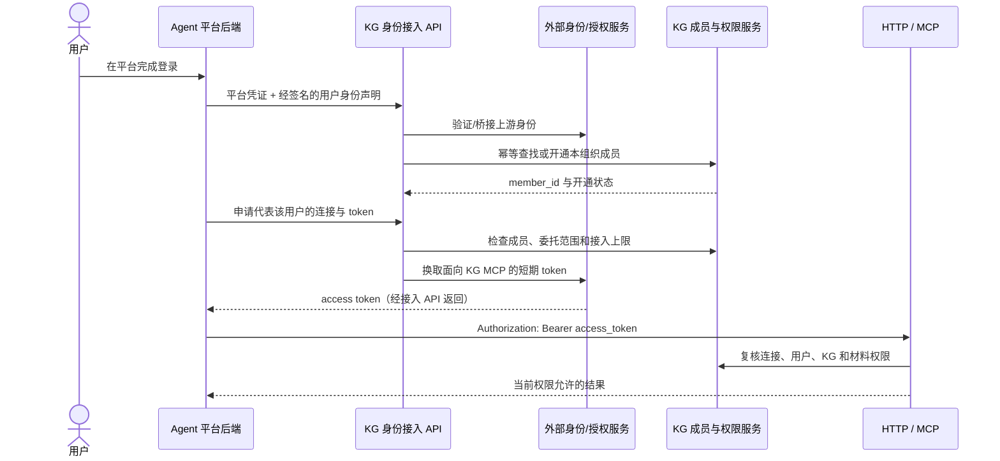

# Agent 身份接入、自动开通用户与 MCP 连接方案

> 状态：2026-10-31 已实施并进行验收；实际公开契约见 [身份接入指南](../../identity-bridge.md)，证据见 [验收记录](../../identity-bridge-verification.md)。保留工作区现有修改，不自动提交或迁移真实用户。本文保留设计背景，实际接口以指南及生成 OpenAPI 为准。

**Goal:** 用户已在一个受信任的 Agent 平台登录时，KG 能通过统一接口验证其身份、按需建立成员关系，并支持 Agent 代表该用户使用可撤销的受限凭证调用 HTTP/MCP。

**Architecture:** Agent 平台负责证明用户身份，外部 OIDC/OAuth 授权服务负责身份桥接和访问 token，KG 负责成员开通、连接限制和实时数据权限。保留现有统一 Policy、组织/KG 隔离与发布前复核；不在 KG 实现密码系统或完整 OAuth 授权服务器。

**Tech Stack:** 现有 Python/FastAPI、MCP SDK 2.3.0、Pydantic、MongoDB 身份与权限权威、外部 OIDC/OAuth 服务。现有本地 Keycloak 可作为首个适配对象，但公共接口不绑定某个 Agent 产品。

**Spec:** 用户本轮要求：不指定平台；Agent 平台已有用户、KG 尚未注册时，以经过验证的平台身份在 KG 开通用户，之后使用 token/session 通信。结合 `docs/design.md`、`docs/contracts.md`、`docs/identity-development.md` 的身份与权限约束。

## 1. 推荐方案及“以 Agent 为准”的范围

采用 **受信任平台 + 按需开通（JIT provisioning）+ 凭证交换 + 服务端连接记录**。

“以 Agent 为准”指以接入平台确认的用户身份和账号启停状态为依据，不是信任模型生成的身份字段，也不是把上游角色直接变成 KG 权限。

| 信息 | 权威来源 |
| --- | --- |
| 这个用户是谁，是否完成上游登录 | 预先接入的平台及其身份服务 |
| 用户在 KG 中对应哪个成员 | KG 的稳定身份映射与成员记录 |
| 属于哪个组织、能读写哪些 KG | KG 本地授权及管理员批准的同步映射 |
| 该 Agent 连接最多能做什么 | 平台接入上限、用户委托范围与连接记录 |
| 浏览器登录 session | 现有 OIDC 登录与 HttpOnly cookie |
| MCP 请求认证 | 面向 KG MCP 资源的 access token |

三个“注册”必须分开：注册 OAuth/MCP 客户端只标识应用；注册上游用户标识一个人；KG 开通成员并授予 KG 角色才产生数据访问权。一个应用获得 client_id 不会因此变成可信身份提供方。

自主运行的 Agent 使用独立 service identity；代表人的 Agent 同时记录用户和调用应用。两者不能互相冒充。

## 2. 已有基础与缺口

现有代码已具备：

- `identity/oidc.py` 验签并检查固定 issuer、audience、有效期和 scope。
- `identity/repository.py` 以组织 + issuer + subject 唯一识别成员，管理员显式 admit 用户。
- `identity/sessions.py` 提供浏览器服务端 session，数据库只保存 session/CSRF token 的 hash。
- `transport/auth.py` 将已验证 MCP token 转换为共享业务服务使用的身份。
- `identity/policy.py` 在执行和返回前复核成员、KG 角色与材料 ACL；后台任务在后续阶段复核权限。
- MCP 当前使用 `stateless_http=True`，不需要靠传输 session 记住“登录用户”。

当前缺口是：未在 KG 入册的用户无法通过认证后继续开通；没有通用的平台信任注册、身份映射/JIT 开通与 token exchange 接口；没有可管理的用户委托连接记录。现有 admit 接口不是自动同步接口，同一个用户换一个请求 key 再次 admit 会冲突。

## 3. 正常使用流程



用户不需要再创建 KG 密码。已经关联的账号重复接入返回同一 `member_id`。尚无已批准 KG 权限时返回“已开通、待分配图谱”，不得伪装成登录失败，也不得为了让首次调用成功而默认开放所有 KG。

首次连接应在平台或 KG 界面展示授权的 KG、读写用途和期限。组织可明确预批准低权限的托管平台接入；超出预批准范围时由用户/相应管理员完成授权。上游登录成功和自动建档本身不代表同意所有 Agent 操作。

## 4. 平台必须先建立信任

组织管理员选择组织和开通策略；平台 operator 批准外部身份端点、签名密钥来源及授权服务适配。后者沿用当前“外部连接由 operator 批准”的边界，普通 Agent 不能自己把某个 issuer 加入信任列表。

每个接入记录至少绑定：`integration_id`、固定组织、允许的上游 tenant/issuer、注册的调用应用、验签配置、允许的开通/同步动作、允许的 KG/操作上限和启停状态。JWT 中的 `iss`/`kid` 只用于在已批准记录中选择密钥，不能触发访问任意 URL。密钥配置使用受控引用；不向客户端返回密钥。

平台后端必须具备专门的机器凭证；用户声明也必须来自该平台认可的签名或受控身份桥接。浏览器或模型直接提交 `{user_id, role}` 不足以开通身份。普通 KG service identity 没有此开通权限。

KG 保持现有 canonical OIDC issuer。其他平台身份先由外部授权服务桥接到稳定的 canonical subject，再写入 KG 成员；不直接把其他平台为自身 API 签发的 token 透传给 `/mcp`。非 OIDC 平台需要一个经过配置的身份桥接适配，而不是放松 MCP token 验证。

第一阶段以现有外部身份服务验证这条适配路径。不同授权服务是否支持所需 subject token、delegation 和连接标识，必须分别验证，不能仅因支持 OAuth 就声称可直接互换。

## 5. 建议 API 契约

下表保留设计意图；实际接口与字段见身份接入指南。普通 MCP tool 不得自行建立信任。

| 接口 | 调用方 | 作用 |
| --- | --- | --- |
| `POST /api/v1/identity-integrations` | 当前组织管理员 + 端点审批策略 | 建立或申请平台接入，明确组织、身份来源和上限 |
| `GET /api/v1/identity-integrations` | 组织管理员；敏感配置 operator 专用 | 查看状态、能力和安全诊断 |
| `PATCH /api/v1/identity-integrations/{id}` | 获准管理员/operator | 版本控制地调整策略或停用接入；不返回凭证 |
| `POST /api/v1/identity-bridge/bootstrap` | 已注册的平台后端 | 验证上游身份，幂等返回或开通 KG 成员 |
| `POST /api/v1/identity-bridge/token` | 已验证的平台后端 | 在批准范围内代表用户交换短期 access token |
| `POST /api/v1/identity-bridge/events` | 获准同步的平台后端 | 幂等同步本平台用户资料、停用/启用及已批准的组映射 |
| `GET /api/v1/me/connections` | 已登录用户 | 列出自己的 Agent 连接、范围、期限和最近使用情况 |
| `POST /api/v1/me/connections/{id}/revoke` | 连接所有者；管理员另有组织管理入口 | 撤销单个连接，立即阻断后续访问与发布 |

### 开通接口示意

```http
POST /api/v1/identity-bridge/bootstrap
Authorization: Bearer <platform-integration-credential>
Idempotency-Key: bootstrap-unique-request-id
Content-Type: application/json

{
  "integration_id": "INTEGRATION_UUID",
  "subject_token_type": "urn:ietf:params:oauth:token-type:jwt",
  "subject_token": "<signed-upstream-user-assertion>"
}
```

签名声明包含已批准的发行方、稳定 `sub`、目标 audience、短有效期及唯一 `jti`；上游租户也必须与接入配置匹配。断言有效期建议至多 120 秒，`jti` 只能被一个成功意图消费。网络重试使用相同幂等 key 时读取既有开通结果，不重新消费声明；换 key 或换意图重放被拒绝。断言不写入日志或长期明文留存。

```json
{
  "member_id": "MEMBER_UUID",
  "created": true,
  "status": "active",
  "connection_allowed": true
}
```

`status` 可为 `active`、`pending_approval`、`suspended`。平台与组织绑定由服务端验证；请求里的 integration ID 只是选择器。需要人工批准时，成员可以建档，但 `connection_allowed=false`，不得签发可用的数据访问凭证。

### 凭证交换

接入 API 是外部授权服务的受控适配层，不是新的完整 OAuth authorization server。标准路径采用 RFC 8693 Token Exchange 的语义：用户身份为 subject、调用平台为 actor、目标 resource 固定为 KG MCP URL；不承诺所有上游 token 都能被交换。

申请字段允许声明更窄的 KG 和 scope，不接受 `owner/admin` 作为自授权参数。服务端验证后创建连接，并要求外部授权服务将连接 ID、用户和调用应用绑定到已验证 token/授权元数据。MCP 只认可签名或受控 introspection 认证过的绑定，不能采用随请求提交的 connection ID。

返回 `access_token`、`token_type=Bearer`、`expires_in` 和连接 ID；默认 access token 有效期 10 分钟。刷新 token 若使用，由外部授权服务签发、轮换和撤销；不在 KG 再建一套刷新协议。第一阶段也允许平台在自己的登录 session 仍有效时提交新的用户证明再交换。授权服务故障时可返回“用户已开通，凭证交换待重试”，不得重复建用户。

## 6. Token 与 session 的职责

推荐 **请求用 token，服务端用连接记录管理授权生命周期**。

`Mcp-Session-Id` 只属于 MCP 传输协议，不是身份凭证；无论是否改用有状态 MCP，所有 HTTP 请求仍须验证 access token。浏览器 cookie 不复制给 Agent，API 密钥也不放在 session ID 或 URL 中。

连接记录包含用户、组织、接入平台/应用、允许的 KG、scope/操作上限、创建/到期/撤销时间和版本。建议连接授权最长 7 天，短期 token 在此范围内续期；部署可由管理员设更短期限。连接 ID 可用于状态查询和审计，本身没有访问能力。

有效权限为：

> 当前用户的组织/KG/材料权限 ∩ 平台接入上限 ∩ 本次用户委托范围 ∩ 连接当前范围 ∩ token scope。

用户是 owner，也不意味着只读 Agent 连接能删除图谱；一个平台停用不能通过另一个平台连接恢复该平台的授权。`org_id` 选择器必须与连接组织一致。新连接默认不开通组织管理、平台运维、永久 purge 和修改模型凭证等高权限动作。

仅支持手动 Bearer header 的客户端可由平台后端提供交换结果；不要求它先实现浏览器 OAuth。需要独立交互登录的标准 MCP 客户端，后续按 OAuth discovery + authorization code/PKCE 接入同一授权服务。长期通用 API key 不作为第一阶段默认方案。

## 7. 用户同步与身份映射

- 稳定映射键使用组织、接入 ID、经过验证的上游 tenant 与 subject。邮箱、昵称仅是资料，不能作为跨平台自动合并依据。
- 首次开通默认普通成员。可由组织管理员和目标 KG owner 事先批准某些 KG 的默认 reader/editor 映射；上游 `admin` 字段不会自动生成 KG admin、owner 或 operator。
- 重复开通返回既有成员，不覆盖本地人工角色和授权；同一幂等 key 不同内容返回冲突。并发首次开通依靠唯一索引和事务只创建一个成员。
- 上游账号停用先阻断该身份认证并撤销相关连接；不要因“最后管理员”不变量拒绝处理停用。必要时让组织进入受限恢复流程，由受控离线管理员恢复入口处理，不能继续放行已停用身份。
- 上游重新启用不会恢复已被本地撤销的 KG grants。资料/组事件使用源版本号，旧事件不能覆盖新状态；角色映射变更独立审计。
- 不同平台确属同一用户时，经过双边身份验证或管理员审核后显式关联到既有 canonical 身份；不批量重写材料、curation、任务和审计里的历史 actor。

## 8. 状态、持久化与故障处理

新增记录建议集中放在现有 MongoDB 身份权威中：

| 记录 | 核心约束 |
| --- | --- |
| `identity_integrations` | 组织绑定、可信身份来源、允许能力、接入版本与启停状态 |
| `identity_links` | 唯一的上游身份键 → canonical 身份及本组织 member ID；保留关联历史 |
| `identity_provisioning_intents` | 组织/接入/请求 key、意图 hash、阶段、结果与安全错误码 |
| `identity_assertion_uses` | issuer/integration/jti 唯一、有效期；原子记录消费与本地意图 |
| `mcp_connections` | 用户、调用应用、当前范围、到期/撤销/版本；不保存明文 access token |

验证断言后再分配身份。外部身份服务操作和 MongoDB 成员提交不能假称跨系统事务：先记可恢复意图，外部创建/映射使用稳定幂等标识，再事务提交本地映射、成员和审计，最后允许交换 token。外部成功、本地失败时重试同一意图；不自动删除可能被其他应用使用的外部账号。

HTTP、MCP、检索返回、缓存和后台 worker 必须消费同一经过验证的委托限制；不能只在网关检查一次。连接的撤销/版本变化参与重新授权和缓存隔离。后台任务保存服务端确认的委托引用及原始范围，重试不能因用户后来获得更大角色而扩权。

正常 access token 过期不取消已被接受的长任务；任务持有独立的已接受工作授权，并在后续阶段、尤其发布前，复核用户、接入、连接和原始委托是否仍有效。撤销连接/停用用户会阻止继续发布，避免 worker 仅凭历史 `actor` 丢掉委托限制。

## 9. 界面与可诊断状态

组织设置新增“身份接入”：平台接入是否启用、身份验证是否通过、默认开通方式、已批准角色映射及最近同步错误。操作员看到受控端点配置；普通管理员看不到密钥。

用户设置新增“Agent 连接”：显示应用、授权 KG/操作、到期时间、最后使用与撤销入口。明确区分“上游未登录”“KG 待批准”“未分配 KG”“连接已撤销”“token 过期可续期”“身份服务暂时不可用”。不得把这些都显示为找不到 KG。

诊断只返回稳定代码、可操作提示和 request ID；不得回传完整上游 token、原始身份响应或用户列表。身份同步测试不调用 LLM，不消耗模型 token。

## 10. 分阶段实施与验证

实施前先用选定外部身份服务验证桥接/Token Exchange 和连接标识能力；不满足就明确调整该适配，不先修改 KG 以接受未经验证的 token。

### 阶段 A：可信接入与幂等开通

预计责任文件：新增 `identity/integrations.py`、`identity/provisioning.py`、`identity/bridge.py` 及对应模型/HTTP router；复用 `identity/repository.py`、`schema.py` 的成员和事务能力。

- [x] 验证未知/停用接入、伪造用户、错误 issuer/audience/client/tenant、断言重放及并发首次开通。
- [x] 将验证与可信提交集中于 IdentityBroker/IdentityBridge 内部方法（见实施决策）；独立 JIT 开通不伪造人类管理员调用 admit。
- [x] 实现接入配置、身份桥接意图、映射、JIT 开通和安全诊断；默认普通成员，不隐式授权 KG。
- [x] 真实 MongoDB 事务验证故障恢复、唯一性、组织隔离与现有管理员不变量。模拟外部 IdP，另外保留真实开发 IdP 验收。

### 阶段 B：用户委托 token 与可撤销连接

预计责任文件：`identity/oidc.py`、`routes.py`、`models.py`、`policy.py`，新增 `identity/connections.py`；`transport/auth.py`、共享 runtime、后台 job 授权/入队与发布路径。

- [x] 写失败测试：平台不能冒充其他接入身份；只读委托不能因用户 owner 身份写入；错误 MCP audience、伪造连接 ID、过期/撤销连接及跨 KG 请求被拒绝。
- [x] 实现 token exchange 适配及经过验证的连接绑定；scope 和动作上限在共享 Policy 中生效，HTTP/MCP 行为一致。
- [x] 在服务端入队、worker、缓存返回及发布前保留并复核委托引用。验证正常 token 过期不丢任务，连接撤销则阻断后续发布。
- [x] 通过真实 IdP → bootstrap → token exchange → MCP 罗列/添加文本/查询 → revoke 的完整闭环；模型使用合成 mock。

### 阶段 C：启停同步与管理界面

预计责任文件：新增 `identity/synchronization.py`、事件模型、console 身份接入和连接管理页面；继续复用现有 grants 和策略服务。

- [x] 验证旧事件、未批准组映射、跨组织选择、固定身份映射、停用最后管理员及恢复；不按邮箱合并。
- [x] 实现顺序/版本控制的资料与启停事件、接入级紧急停用和用户撤销连接。
- [x] 通过真实存储权限/并发/撤销测试及界面测试，记录两类主体的审计：人类用户与调用平台。

后续按实际需求接入 SCIM 批量目录同步、多来源账号显式关联与标准 MCP 客户端交互登录。第一阶段不先构建所有厂商连接器，不自动迁移现有语料或用户。

## 11. 兼容与回退

现有 OIDC 登录、已入册用户、浏览器 session 和 service identity 路径继续工作。新接入先只对明确批准的 integration 启用。现有 member UUID、KG grants、材料 ACL、历史 actor 和幂等意图指纹保持稳定；新增可选内部字段默认省略，避免改变旧封存 payload。

回退时停用新 identity integration、撤销其连接并恢复旧 token 验证入口；已创建成员保留为可审计记录，不能批量删除用户或重写归属。无需重建 KG 图/向量投影。必须验证停用新路径后旧路径仍可登录，且新凭证不能借旧路径绕过接入撤销。

## 12. 参考与尚需实测的边界

- [MCP 授权规范](https://modelcontextprotocol.io/specification/2026-07-28/basic/authorization)：KG 是 resource server，验证目标资源 token；标准客户端走发现与 OAuth。客户端注册机制要按客户端/授权服务实际支持核实，不能把动态客户端注册当成用户注册。
- [MCP 安全实践](https://modelcontextprotocol.io/specification/2026-07-28/basic/security_best_practices)：session ID 不作为认证，禁止 token passthrough。
- [RFC 8693](https://www.rfc-editor.org/rfc/rfc8693)：subject/actor、目标 resource 和 token exchange 的标准语义；需要具体授权服务实现相应 profile。
- [Keycloak 官方管理文档](https://www.keycloak.org/docs/latest/server_admin/index.html)：外部 OIDC/SAML brokering 和 LDAP/AD federation 是不同能力；通用 Agent 用户开通仍需本方案的接入协议与策略。

实现已对照上述官方文档，并通过隔离 Keycloak 26.8.1 同 realm 标准交换及完整 HTTP/MCP/worker/撤销验收。未配置任何真实外部平台；跨 issuer、其他 IdP 与独立 MCP 客户端的交互登录仍需各自验收。


## 2026-10-31 实施记录

- 执行方式：executing-plans + TDD + lean-build，原生执行，工作区已有活动分支；不创建新 checkout 或自动 commit。
- Ruling: 保留外部 OIDC 签发 JWT；连接通过 access-token SHA-256 与 MongoDB 记录绑定。登记的交换 client 所有未绑定 token 都拒绝，撤销后不回退到普通 token 路径。这样无需假定授权服务支持自定义 connection claim，也不自建 OAuth issuer。
- Ruling: 通用适配支持已批准 subject issuer 与 RFC 8693 交换；Keycloak profile 将固定 MCP resource 映射到受控 audience client。不同发行方桥接仍取决于该授权服务配置，不启用 Keycloak preview impersonation。
- Ruling: 重放 token 响应仅使用配置密钥加密短期保存，数据库不存明文 token；意图与断言消费分阶段、可恢复，外部服务不参与 Mongo 事务。
- [x] A/B/C 实现、真实存储边界验证、外部接口文档、开发 IdP 证明和交付检查。

### 实施决策与实际边界

- Ruling: 信任 profile 固定；首阶段 integration 的 PATCH 只控制启停。KG/动作/默认授予/组映射策略变化采用新专用 profile/client/integration 并停用旧接入；不在已有授权记录上静默扩权。代价是策略变更需要重新登记与连接，详见公开指南。
- Ruling: 不另造可从请求构造的 verified-context 公共模型。验证集中于 IdentityBroker 与 IdentityBridge.process，已验证 canonical 身份只流入内部提交方法；组织/KG 权限仍由当前 Policy 检查，代价是这些内部调用边界必须继续保持私有。
- Ruling: member_identity_states 只标识由接入管理的账号；有效审批由当前可用的关联计算。单个关联撤回审批不覆盖另一有效关联；任一关联的明确上游停用则阻断整个组织成员，并撤销其组织内连接。
- Ruling: 上游可停用最后管理员，返回 recovery_required；不提供绕过上游验证的公网解禁接口。恢复通过可信上游的更高版本 enable 或部署方预留的独立受控管理员渠道，代价是该渠道需要部署方保障。
- 已完成对外指南、固定版本 IdP 部署说明、生成 OpenAPI、平台客户端示例、控制台审批/撤销和真实存储/身份服务验收；最终命令结果见验收记录。

- Ruling: 明确的接入停用与关联审批撤回属于紧急信任撤销，可使最后可用 owner/admin 被阻断；不以维持可用性为由拒绝撤销。普通角色/授权修改仍保留有效 owner/admin。代价是部署必须保留独立可信恢复渠道，界面与公开指南已明确提示。
